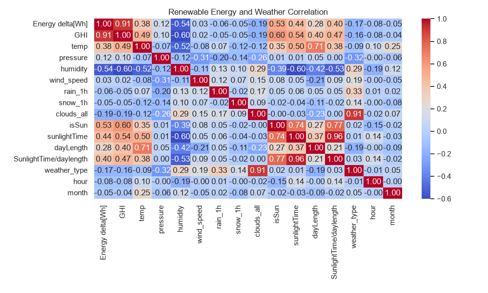
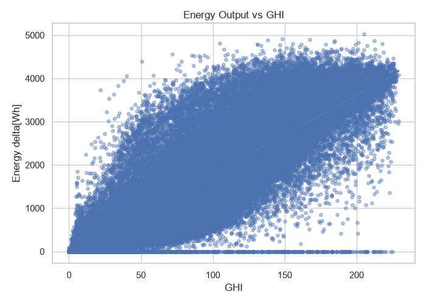
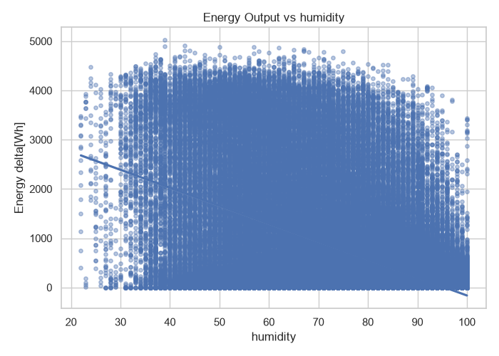
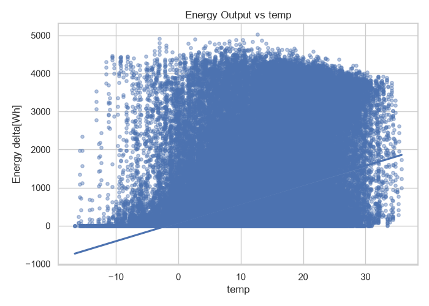
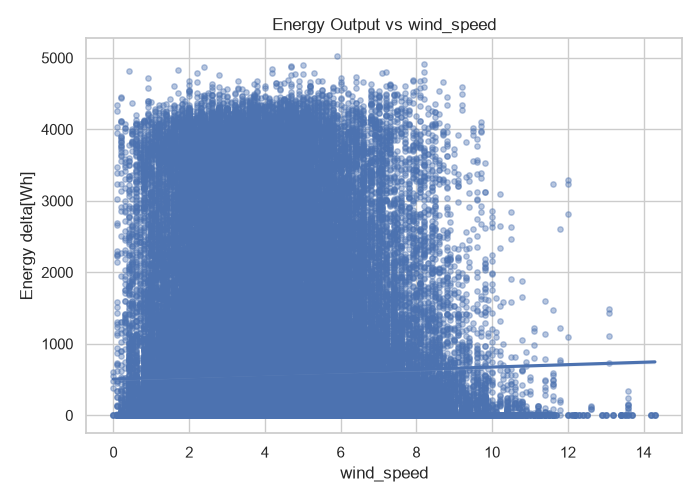
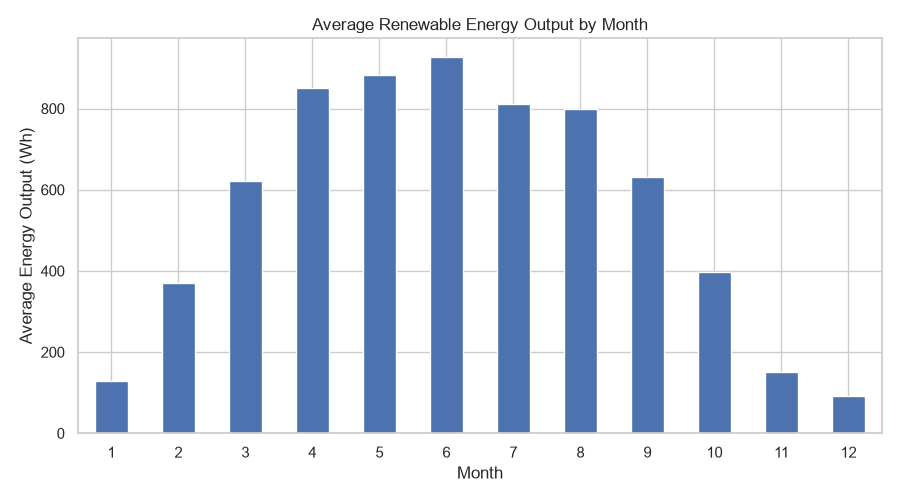
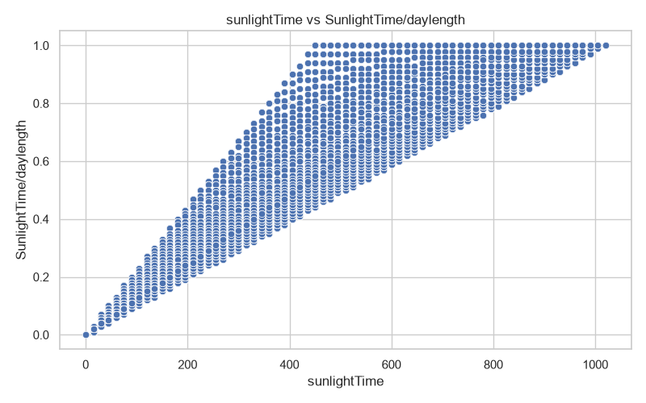

# Global Renewable Energy Output and Weather Correlation

AI101 - Data Science and AI Essentials with Python
School of AI and Data Engineering, IIT Ropar
Project ID: ai101_project82

## About the project

Solar panels don't give the same amount of energy all the time. A sunny day gives a lot, a cloudy or humid day gives less, and winter gives much less than summer. We wanted to find out how much each weather factor actually matters.

For this we used a dataset of about 196,000 readings that have both weather data (sunlight, temperature, humidity, wind speed, clouds, rain, snow) and the energy produced at that time. We cleaned the data, looked for patterns, made graphs, and then trained two simple machine learning models to predict energy output.

What we wanted to do:

- Clean the data and check it properly
- Find which weather factors are linked to energy output
- Show the results with graphs and a heatmap
- Train simple models to predict the output

## Presentation and video

- Presentation:https://github.com/anishiitrpr/ai101_project82/blob/c6dd8f09eedc31c15e438abaf49535ca996c10bb/docs/sehajreen_group82_miniproject.pdf


- Demo video: https://drive.google.com/file/d/1tMJx12k1yv1HUGEdUWCQuaKLtxH8mLHD/view?usp=drivesdk

## Quick start

If Python is already installed, these three commands are enough:

```bash
git clone https://github.com/anishiitrpr/ai101_project82.git
cd ai101_project82
pip install -r requirements.txt
python src/main.py
```

This cleans the data, makes all the graphs, trains the models and saves the pictures in the `results/` folder. Run it from the main project folder (the one that has `src/` and `data/` inside it), otherwise the file paths will not work.

More detailed setup steps are given further below.


## Team

| Name | Roll Number | Role |
|---|---|---|
| Dharmesh Meena | 2026AIB1030 | Documentation Lead |
| Anish Kumar | 2026AIB1015 | Video Lead |
| Parmeet | 2026EEB1390 | Execution Lead |
| Sehajpreet Singh Reen | 2026EEB1409 | PPT Lead |

## Dataset

We used the "Renewable Power Generation and Weather Conditions" dataset from Kaggle, made by pythonafroz.

Link: https://www.kaggle.com/datasets/pythonafroz/renewable-power-generation-and-weather-conditions

The file is `data/Renewable.csv`. Some basic facts about it:

- 196,776 rows and 17 columns
- Readings every 15 minutes, from 1 January 2017 to 31 August 2022
- No missing values and no duplicate rows

Columns:

| Column | Meaning |
|---|---|
| Time | Date and time of the reading |
| Energy delta[Wh] | Energy produced in that interval. This is the value we are studying and predicting |
| GHI | Amount of sunlight reaching the ground |
| temp | Temperature in degrees Celsius |
| pressure | Air pressure |
| humidity | Moisture in the air, in percent |
| wind_speed | Wind speed |
| rain_1h, snow_1h | Rain and snow in the last hour |
| clouds_all | How much of the sky is covered by clouds, in percent |
| isSun | Whether the sun is up |
| sunlightTime | Minutes of sunlight so far |
| dayLength | Total length of the day |
| SunlightTime/daylength | Sunlight time divided by day length |
| weather_type | Weather category stored as a number |
| hour, month | Hour of the day and month of the year |

## What we did

1. Looked at the data (size, column types, first few rows).
2. Cleaned it: checked for missing values and duplicates, and converted the Time column to a proper date-time format.
3. Explored it with summary statistics.
4. Calculated correlations between all the columns.
5. Made graphs: a heatmap, scatter plots and a monthly bar chart.
6. Trained a Linear Regression model and a Logistic Regression model.
7. Wrote down what we found.

All of these steps run one after another from `src/main.py`.

## Folder structure

```text
ai101_project82/
├── README.md
├── requirements.txt
│
├── data/
│   └── Renewable.csv                       original dataset
│
├── docs/
│   ├── Presentation.md
│   ├── Video.md
│   ├── presentation_sehajreen.pptx
│   └── sehajreen_group82_miniproject....   (name is cut off in the screenshot)
│
├── src/
│   ├── main.py                             runs everything in order
│   ├── preprocessing.py                    step 1, cleaning
│   ├── visualization.py                    step 2, statistics and graphs
│   └── model.py                            step 3, model training
│
└── results/                                graphs are saved here
    ├── correlation_heatmap.png
    ├── energy_vs_GHI.png
    ├── energy_vs_temp.png
    ├── energy_vs_humidity.png
    ├── energy_vs_wind_speed.png
    ├── monthly_energy_comparison.png
    └── scatter_comparison.png
```

What each script does:

- `main.py` runs the other three scripts in order using Python's `subprocess` module. It also sets the main project folder as the working directory, so the code finds `data/Renewable.csv` and saves outputs in the right place no matter where you start it from.
- `preprocessing.py` cleans the raw data and saves `cleaned_data.csv`.
- `visualization.py` prints the statistics and correlations and saves the graphs in `results/`.
- `model.py` trains the models and prints their scores.

## Setup in detail

1. Clone the repository

```bash
git clone https://github.com/anishiitrpr/ai101_project82.git
cd ai101_project82
```

2. Create a virtual environment (optional, but it keeps the project libraries separate from the rest of your system)

Windows:
```bash
python -m venv venv
venv\Scripts\activate
```

Mac or Linux:
```bash
python3 -m venv venv
source venv/bin/activate
```

3. Install the libraries

```bash
pip install -r requirements.txt
```

`requirements.txt` should contain:

```text
pandas
numpy
matplotlib
seaborn
scikit-learn
```

4. Make sure `Renewable.csv` is inside the `data/` folder.

5. Run the project

```bash
python src/main.py
```

Use `python3` instead of `python` on Mac or Linux if needed. If everything works, the last line printed in the terminal is "All steps completed successfully!". After that you can open the `results/` folder to see the graphs.

## Results

### Data cleaning

After cleaning, the data still has 196,776 rows and 17 columns. There were no missing values and no duplicates, so nothing had to be removed. The Time column was converted to date-time format.

### Basic statistics

| | Energy (Wh) | GHI | Temp (C) |
|---|---|---|---|
| Mean | 573.0 | 32.6 | 9.8 |
| Minimum | 0 | 0 | -16.6 |
| Maximum | 5020 | 229.2 | 35.8 |

The median energy is 0. This is because readings are taken every 15 minutes through the whole day, and at night there is no sunlight, so a large number of readings are exactly 0.

### Correlation with energy output

A correlation value is between -1 and +1. A value near +1 means two things increase together, near -1 means one increases while the other decreases, and near 0 means there is no real relationship.

| Column | Correlation with energy |
|---|---|
| GHI | 0.915 |
| isSun | 0.53 |
| sunlightTime | 0.44 |
| SunlightTime/daylength | 0.40 |
| temp | 0.379 |
| dayLength | 0.28 |
| pressure | 0.12 |
| wind_speed | 0.029 |
| weather_type | -0.17 |
| clouds_all | -0.19 |
| humidity | -0.544 |



A few other things we noticed in the heatmap:

- clouds_all and weather_type are very closely related (0.91).
- sunlightTime and SunlightTime/daylength are very closely related (0.96).
- temp and dayLength are related (0.71), since summer days are both longer and warmer.
- humidity and GHI have a negative correlation (-0.60), so humid conditions usually have less sunlight.

### Graphs

Energy vs GHI: this is the clearest pattern in the whole project. Energy increases almost in a straight line as GHI increases, reaching about 4000 Wh at the highest values. There is also a flat line of points at zero energy even for high GHI. We are not sure why. It might be because of equipment downtime or snow on the panels, but we have not checked this.



Energy vs humidity: energy goes down as humidity goes up. Humid weather usually means clouds or rain, which block the sun, so humidity is probably affecting energy indirectly.



Energy vs temperature: energy increases from freezing temperatures up to around 10 to 25 degrees and then flattens out. Warm temperatures mostly happen in sunny summer months, so temperature is more of a sign of the season than a direct cause.



Energy vs wind speed: the points are spread everywhere and the trend line is almost flat (correlation 0.029). Wind speed does not seem to affect solar energy, which makes sense because solar panels depend on sunlight.



Average energy by month:

| Month | Average energy (Wh) | Month | Average energy (Wh) |
|---|---|---|---|
| January | 129.56 | July | 811.02 |
| February | 369.19 | August | 798.92 |
| March | 620.64 | September | 631.77 |
| April | 851.11 | October | 397.34 |
| May | 881.58 | November | 151.74 |
| June | 926.40 | December | 91.23 |

June has the highest average and December has the lowest. June is about 10 times higher than December.



sunlightTime vs SunlightTime/daylength: this plot shows that the ratio column is calculated from sunlightTime and the day length, which is why the two are so strongly correlated.



### Model results

| Model | Metric | Score |
|---|---|---|
| Linear Regression | R2 score | 0.847 |
| Linear Regression | RMSE | 411.25 Wh |
| Logistic Regression | Accuracy | 0.929 |

The R2 score of 0.847 means the Linear Regression model explains about 85% of the variation in energy output. The RMSE of 411.25 Wh means its predictions are off by around 411 Wh on average. For comparison, the average energy in the dataset is about 573 Wh and the maximum is 5020 Wh. The Logistic Regression model classified about 93% of the cases correctly.

<!-- TODO: add one line here saying what the Logistic Regression model predicts (the target used in model.py) -->

## Conclusions

- Sunlight (GHI) has by far the strongest relationship with energy output, with a correlation of 0.915.
- Humidity has a moderate negative relationship (-0.544), most likely because humid weather comes with clouds and less sunlight.
- Temperature has a weak positive relationship (0.379), mostly because it follows the seasons.
- Wind speed has almost no relationship with solar energy (0.029).
- Output depends a lot on the season. It is highest from April to August and lowest in winter.
- Even simple models gave good scores (R2 of 0.847 for regression and 92.9% accuracy for classification).

## Glossary

- GHI: Global Horizontal Irradiance, the amount of sunlight falling on a flat surface
- Wh: Watt-hour, a unit of energy
- Correlation: a number that shows how strongly two things move together
- EDA: Exploratory Data Analysis, looking through the data with statistics and graphs to find patterns
- Heatmap: a colour-coded table, used here to show the correlation between every pair of columns
- Linear Regression: a model that predicts a number by fitting a straight-line relationship
- Logistic Regression: a model that predicts a category, for example yes or no
- R2 score: how much of the variation in the data the model explains (closer to 1 is better)
- RMSE: Root Mean Squared Error, the typical size of the model's prediction error (lower is better)
- Accuracy: the fraction of predictions that were correct

## Limitations

- The data is from one solar installation, so the results may not be the same for other places.
- The dataset has no country-wise data and no separate wind or hydropower data, even though the project title says renewable energy.
- Correlation does not mean causation. For example, humidity is linked with low energy, but clouds are probably the real reason.
- Some columns are nearly copies of each other (like clouds_all and weather_type), which can affect the models.
- The straight trend lines on some graphs are only rough guides. The one on the temperature graph goes below zero energy, which is not possible in real life.
- The model scores depend on which columns were used and how the data was split, so they should be seen as baseline results.
- Energy output also depends on things that are not in the data, such as panel size, equipment and maintenance.

## Troubleshooting

FileNotFoundError for Renewable.csv: the file is not in the `data/` folder, or the code was run from the wrong folder. Put the file in `data/` and run from the main project folder.

ModuleNotFoundError: No module named 'sklearn': scikit-learn is not installed. Run `pip install scikit-learn`. It was missing from our first requirements.txt.

git pull gives an error about Renewable.csv: a local copy of the file clashes with the one on GitHub. Delete or move the local copy and run `git pull origin main` again.

Pandas4Warning about select_dtypes: this is only a warning, the code still works. It appears because newer pandas versions handle text columns differently. Using `include=["object", "str"]` in `visualization.py` removes it.

## AI use disclosure

We used AI tools as support while working on this project.

- ChatGPT: understanding Python concepts, debugging, code suggestions, README writing and guidance on the data analysis.
- Claude: Python coding help, fixing errors, organising the project folders, GitHub help and drafting the README.
- Checking: all AI suggestions were read by the team, changed where needed, and tested on our own computers before we used them.

AI tools helped with the process, but they did not replace our own understanding, implementation and testing.
